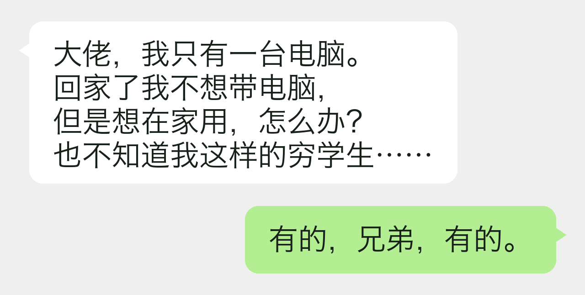

# 飞书 Codex 机器人

在电脑或手机上打开飞书，都可以私聊机器人，或在群里 @ 它。协作群开启免 @ 后，可以直接发任务。你可以发送文字、图片或图文消息，Mac 上的 Codex CLI 会处理任务并把结果发回飞书，你可以在同一段对话里继续追问。可以只建一个机器人，也可以给不同项目建多个。每个机器人有自己的角色、模型、工作目录和对话状态。

工具会优先使用 ChatGPT 桌面应用附带的 Codex CLI，沿用本机 CLI 已保存的登录状态。飞书通过长连接传消息，因此这台电脑保持开机联网、工具保持运行即可，无需公网回调地址。



## 安装

需要 macOS、Node.js 22 或更新版本，以及已通过 ChatGPT 账号登录的 Codex CLI。

```sh
git clone https://github.com/mengxiangsama/feishu-codex-bot.git
cd feishu-codex-bot
./Start.command
```

也可以在访达中双击 `Start.command`。它会按需安装依赖并打开配置菜单。

## 新建第一个机器人

1. 打开[飞书开发者后台](https://open.feishu.cn/app)，选择要使用的飞书组织，然后点**创建企业自建应用**。应用名称会作为飞书里显示的机器人名称。进入**应用能力 → 添加应用能力 → 机器人**并启用。
2. 在**权限管理**开通下列应用身份权限。支持批量导入的后台可以使用 [feishu-permissions.json](feishu-permissions.json)。
   - `im:message.p2p_msg:readonly` 接收用户发给机器人的私聊。
   - `im:message.group_at_msg:readonly` 接收群里 @ 机器人的消息。只需要私聊可以不加这一项。
   - `im:message:readonly` 下载收到的消息中的图片。[飞书消息资源接口](https://open.feishu.cn/document/server-docs/im-v1/message/get-2)
   - `im:message:send_as_bot` 以机器人身份回复。
3. 在**凭证与基础信息**找到 App ID 和 App Secret。双击 [Start.command](Start.command)，选 **2. 新建或更新机器人**。在本机终端填入凭证，接着设置角色、模型 ID、推理强度和工作目录。App Secret 输入时不显示。模型和推理强度可分别输入 `-` 选择 Codex 默认值。
4. 再打开启动工具，选 **1. 启动桥接**。保持窗口打开，等终端显示**飞书长连接在线**。
5. 回到后台，进入**事件与回调 → 事件配置**，订阅方式选**使用长连接接收事件**并保存，然后添加**接收消息**事件 `im.message.receive_v1`。保存长连接配置时需要本机客户端已在线。[飞书长连接文档](https://open.feishu.cn/document/ukTMukTMukTM/uYDNxYjL2QTM24iN0EjN/event-subscription-configure-)
6. 进入**版本管理与发布**并创建版本。可用范围先选自己，提交发布。如果租户要求审批，等管理员通过。
7. 在飞书搜索你的机器人并私聊。按本机终端提示发 `/pair 绑定码` 完成首次绑定，然后发送“请用一句话介绍你能做什么”。绑定后只有这个飞书账号能让机器人执行任务。需要群聊时，把已发布的机器人加到群里再 @ 它。[飞书机器人文档](https://open.feishu.cn/document/client-docs/bot-v3/bot-overview?lang=zh-CN)

## 再建一个机器人

再创建一个飞书自建应用，重复设置机器人能力、权限和事件。启动工具选 **2**，输入另一个 App ID，就会新增一条配置。使用同一个 App ID 会更新原配置。重启桥接后可同时运行多个机器人。各飞书机器人用各自的配对码，群聊和私聊也各自保存上下文。

本机配置的名称用于终端及机器人回复。要改飞书里显示的名字，请在飞书应用后台改名称并按后台提示发布。

## 模型和推理强度

每个机器人可以设置不同的 Codex 模型和推理强度。请使用当前账号和模型支持的组合，例如支持时可选 `ultra`。更新已有机器人时，直接回车保留当前设置，输入 `-` 恢复 Codex 默认值。推理强度改动在重启桥接后生效，可以继续原会话。

请代理代建机器人时，可以直接指定模型和推理强度。少写一项时，代理会询问缺少的那一项。两项都未指定时，代理会一起询问。也可以明确选择使用 Codex 默认值。

## 终端命令

需要 Node.js 22 或更新版本。在工具所在目录执行下列命令。双击启动工具时会按需安装依赖。

```sh
npm ci --ignore-scripts
npm run setup
npm run check
npm start
```

- `npm run list` 查看已配置的机器人。
- `npm start -- "机器人名称"` 只启动一个已配置的机器人。
- `npm run check` 检查 Codex 是否已登录和飞书应用凭证是否有效。飞书的发布、可用范围和收发消息权限仍需以实际私聊测试为准。
- `/status` 查看状态，`/new` 开新会话，`/stop` 停止当前会话的任务并清空它的排队请求，`/help` 查看帮助。

## 工作目录和权限

默认给每个机器人创建独立目录，Codex 以只读模式运行。需要让它修改项目时，在向导里选定项目目录，并选择允许修改工作目录。只读限制文件修改，可读取的范围由 Codex 沙箱决定。目录、写权限或模型变化后需要重新绑定并开始新对话。

Mac 上优先使用 `/Applications/ChatGPT.app/Contents/Resources/codex-cli/CodexCLI.app/Contents/MacOS/codex`。如果 ChatGPT 安装在其他位置，可设置 `FEISHU_CODEX_BIN` 为对应的 Codex CLI 可执行文件路径再启动。没有找到内置 CLI 时会尝试 PATH 上的 `codex`。

Codex 使用本机登录发起模型请求，电脑仍要联网。机器人的任务在本机目录里运行。重启桥接后可以继续之前的会话，未执行的队列任务需要重新发送。凭证和会话对应关系保存在工具下的 `.local` 目录，请在本机保留这个目录。

## 发送图片

已有机器人需要在飞书应用后台的**权限管理**开通应用身份权限 `im:message:readonly`，再到**版本管理与发布**创建并发布新版。需要审批时，等管理员通过后再测试。

在私聊直接发图片，机器人会描述图片。需要问具体问题时，把文字和图片放在同一条富文本消息中。在指定协作群里，把 @ 负责人、问题和图片放在同一条消息中，负责人规划、执行者处理和负责人审查都会收到图片。协作群开启免 @ 后，可以直接发图片或图文消息。

图片支持 PNG、JPEG、WebP 和 GIF，每张不超过 10 MiB。桥接把消息中的图片下载到任务专用临时目录，每张图片的下载超时为 10 秒。任务完成、失败或取消后清理该目录。识图需要所使用的 Codex 模型支持图片输入。

## 在一个群里配置负责人和多个执行机器人

绑定机器人后，在本机数据目录 `.local` 新建 `team.json`，填入负责人的飞书 App ID、一个或多个执行机器人的 App ID，以及要启用协作的群 ID。

```json
{
  "version": 1,
  "leaderAppId": "cli_领导应用的ID",
  "workerAppIds": ["cli_第一只执行机器人的ID", "cli_第二只执行机器人的ID"],
  "chatId": "oc_目标群的ID",
  "noMention": false
}
```

已有的 `workerAppId` 单执行者配置仍可使用。新增执行者时，先用 `npm run setup` 配好对应的自建应用，再把 App ID 加入 `workerAppIds`，最后重启桥接。

同时启动负责人和执行者后，由已绑定的用户在指定群直接 @ 负责人，例如 `@负责人 写一份机器人使用说明`，会默认进入协作，也可沿用 `/协作 任务描述`。负责人规划完成后，桥接按配置顺序选一只没有在执行或排队的机器人。全部忙时会报告等待，并派给先空闲的执行者。被选中的机器人执行期间，直接发给它的任务会排队。

协作任务使用负责人的固定工作目录：负责人只读规划，执行者按负责人的目录权限工作，负责人再只读审查。后续协作会继续同一群和同一用户的负责人会话，并使用同一个目录，因此可以接着处理未提交改动；`/new` 开始新对话，但不会删除项目文件。私聊、其他群和单独 @ 执行者仍是单独对话。要取消协作任务，在同一个群发送 `@负责人 /stop`。

执行者工作期间，可以继续 @ 负责人提问或安排另一项任务。负责人会根据已有状态回答问题，也可以将独立任务分配给空闲执行者；没有空闲执行者时会等待。多个执行者共享同一项目目录，处理相同文件或互相依赖的任务可能冲突，建议等前一项完成再安排。`/stop` 会停止该会话当前所有协作任务，`/new` 在这些任务完成或停止后使用。

Codex CLI 会读取本机用户配置，包括配置的 MCP 服务器。需要审批的操作使用自动审批审查，结果可能获准或被拒绝；具体工具是否可用取决于本机认证、服务状态、沙箱及审批配置。推送 GitHub 前需先配置有对应仓库权限的认证，并确认网络允许访问。桌面应用的连接能力不一定能在 CLI 中直接使用。只读沙箱限制文件和命令权限，MCP 服务自身的权限与可执行操作需另行检查。

### 在协作群免 @ 发消息

1. 在**负责人应用**的飞书开发者后台，进入**权限管理**，申请应用身份权限 `im:message.group_msg`（获取群组中所有消息，敏感权限）。执行机器人沿用原有权限。该权限会向负责人应用投递它所在各群的用户消息，桥接只在 `chatId` 对应的协作群接受已绑定账号发来的免 @ 消息。[飞书消息接收权限](https://open.feishu.cn/document/uAjLw4CM/ukTMukTMukTM/reference/im-v1/guide/faq)
2. 在**事件与回调 → 事件配置**确认已订阅 `im.message.receive_v1`（接收消息），在**版本管理与发布**创建并发布新版。按租户要求完成管理员审核，确认负责人已加入协作群。
3. 把现有 `.local/team.json` 中的 `noMention` 设为 `true`，保留原群 ID 和机器人配置，然后重启桥接。省略这一项或设为 `false` 会恢复群里 @ 负责人触发协作。

开启后，已绑定账号可以直接在该群发送第一条任务、继续追问、发图片或输入 `/stop`。如果消息只 @ 了别人（含其他机器人或 @ 所有人），负责人会跳过这条消息。私聊、其他群里 @ 机器人、单独 @ 执行者，以及显式 @ 负责人的用法照常可用。

## 排查连接

- 如果启动后长时间没有显示「正在连接飞书」，先关闭桥接，再在项目目录运行 `npm ci --ignore-scripts` 重装依赖，然后重新启动。重装依赖会重建 `node_modules`，机器人配置仍保存在 `.local`。
- 如果后台提示没有长连接，先在工具里运行 `npm run check`，再运行 `npm start`，看到长连接在线后再保存事件配置。
- 如果飞书搜不到机器人，检查是否选择了正确的飞书组织，以及应用版本是否已发布、你的账号是否在可用范围内。
- 如果机器人不回复，先私聊发送 `/help`，核对本机是否正在运行、账号是否绑定、是否已订阅接收消息事件，以及发送权限是否已发布。
- 如果 @ 负责人有回复但协作群的普通消息无回复，检查 `noMention` 是否为 `true`、是否已重启桥接，以及负责人应用的 `im:message.group_msg` 是否随新版发布。
- 如果启动时提示无法获取机器人 Open ID，检查应用的机器人能力、发布状态和本机网络。桥接会自动重试，取得该 ID 后恢复识别群里的 @ 对象。
- 如果文字能正常处理但图片下载失败，检查收到消息的机器人应用是否已开通并发布 `im:message:readonly`。
- 若意外关机后工具提示已有启动记录，请确认提示中的进程已经结束，再删除 `.local/running.pid` 后重启。

[Codex CLI 非交互模式与会话恢复](https://learn.chatgpt.com/docs/non-interactive-mode)

## 测试与许可证

在项目目录运行 `npm test`。测试覆盖绑定、去重、会话恢复、图片下载和 Codex 子进程。使用已发布的自建应用验证识图时，可在私聊发送只有图片上写有随机短码的截图，再在同一会话发送一张不同短码的截图。在协作群中可把 @ 负责人、截图和读取短码的问题放在同一条消息里。开启免 @ 后，可直接发送「8 + 9 等于多少？」再追问「再加 1 呢？」并确认只有负责人发来回复。

源码采用 [MIT 许可证](LICENSE)。
